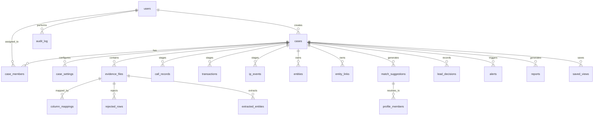

# Database Architecture & Data Model (DATABASE.md) — Case Connect AI

**Product:** Case Connect AI — Criminal Network Analysis System  
**Document Version:** 1.0.0  
**Status:** Approved Source of Truth  
**Primary Database Technology:** SQLite 3 (WAL Mode) with SQLAlchemy ORM  
**Disposable Graph Engine:** Neo4j Community Edition 5.x / NetworkX In-Memory  
**Foundational References:** PRD.md & ARCHITECTURE.md  

---

## 1. Database Technology & Storage Strategy

### 1.1 Dual-Store Architecture
Case Connect AI uses an intentional two-tier data architecture designed for forensic immutability, legal compliance, and graph traversal performance:
1. **SQLite 3 (Authoritative Source of Truth):**
   - Single-file relational store (`app.db`).
   - Stores all raw evidence records, canonical parsed data, officer decisions, merge histories, and the cryptographic audit trail.
   - Operates with Write-Ahead Logging (`PRAGMA journal_mode = WAL`) and full foreign-key enforcement (`PRAGMA foreign_keys = ON`).
2. **Neo4j 5.x / NetworkX (Disposable Graph Index):**
   - Read-optimized graph projection engine.
   - Nodes and relationships are projected directly from SQLite tables (`entities` and `entity_links`).
   - If the graph becomes corrupt, desynchronized, or re-indexed, the system executes `rebuild_graph(case_id)`, which wipes and regenerates the graph index from SQLite with 100% fidelity.

---

## 2. Entity-Relationship Diagram (ERD)

---

## 3. Relational Schema Specifications (SQLite Tables)

### Table 1: `users`
System user directory supporting Role-Based Access Control (RBAC).
| Column Name | Type | Constraints | Description |
| :--- | :--- | :--- | :--- |
| `id` | `VARCHAR` | PK, Default UUIDv4 | Unique user identifier |
| `username` | `VARCHAR` | Unique, Index, NOT NULL | Officer username |
| `password_hash` | `VARCHAR` | NOT NULL | Salted bcrypt hash (12 rounds) |
| `role` | `VARCHAR` | NOT NULL, Default `'investigator'` | System role: `admin`, `investigator`, `viewer` |
| `is_active` | `BOOLEAN` | NOT NULL, Default `TRUE` | Account active status |
| `created_at` | `DATETIME` | NOT NULL, Default UTC | Account creation timestamp |

### Table 2: `cases`
Investigation dockets isolating all digital evidence, entities, and analyses.
| Column Name | Type | Constraints | Description |
| :--- | :--- | :--- | :--- |
| `id` | `VARCHAR` | PK, Default UUIDv4 | Case docket identifier |
| `title` | `VARCHAR` | NOT NULL | Official case title / FIR title |
| `description` | `TEXT` | NULL | Case briefing / investigative notes |
| `priority` | `VARCHAR` | NOT NULL, Default `'medium'` | Priority level: `high`, `medium`, `low` |
| `status` | `VARCHAR` | NOT NULL, Default `'active'` | Docket status: `active`, `analysis`, `closed` |
| `created_by` | `VARCHAR` | FK -> `users.id`, NOT NULL | Creator officer ID |
| `created_at` | `DATETIME` | NOT NULL, Default UTC | Docket creation timestamp |

### Table 3: `case_members`
User assignment table enforcing Broken Object Level Authorization (BOLA/IDOR) defense.
| Column Name | Type | Constraints | Description |
| :--- | :--- | :--- | :--- |
| `id` | `VARCHAR` | PK, Default UUIDv4 | Membership record ID |
| `case_id` | `VARCHAR` | FK -> `cases.id`, Index, NOT NULL | Associated case docket |
| `user_id` | `VARCHAR` | FK -> `users.id`, Index, NOT NULL | Assigned officer ID |
| `role` | `VARCHAR` | NOT NULL, Default `'investigator'` | Case role assignment |
| `added_at` | `DATETIME` | NOT NULL, Default UTC | Assignment timestamp |

### Table 4: `case_settings`
Configurable scoring thresholds and weights per case docket.
| Column Name | Type | Constraints | Description |
| :--- | :--- | :--- | :--- |
| `id` | `VARCHAR` | PK, Default UUIDv4 | Setting record ID |
| `case_id` | `VARCHAR` | Unique, Index, NOT NULL | Associated case docket |
| `settings_json` | `TEXT` | NOT NULL | JSON payload with case thresholds |
| `updated_at` | `DATETIME` | NOT NULL, Default UTC | Last update timestamp |

### Table 5: `evidence_files`
Catalog of uploaded digital evidence files with cryptographic SHA-256 integrity proofs.
| Column Name | Type | Constraints | Description |
| :--- | :--- | :--- | :--- |
| `id` | `VARCHAR` | PK, Default UUIDv4 | Evidence file identifier |
| `case_id` | `VARCHAR` | FK -> `cases.id`, Index, NOT NULL | Associated case docket |
| `original_name` | `VARCHAR` | NOT NULL | Original uploaded filename |
| `stored_path` | `VARCHAR` | NOT NULL | Secure storage path on disk |
| `sha256` | `VARCHAR` | Index, NOT NULL | SHA-256 cryptographic hash of raw file |
| `file_size` | `INTEGER` | NOT NULL | File size in bytes |
| `detected_type` | `VARCHAR` | NULL | `cdr`, `bank_transactions`, `sdr`, `fir` |
| `status` | `VARCHAR` | NOT NULL, Default `'uploaded'` | `uploaded`, `mapped`, `ingesting`, `ingested`, `failed` |
| `uploader_id` | `VARCHAR` | FK -> `users.id`, NOT NULL | Uploading officer ID |
| `created_at` | `DATETIME` | NOT NULL, Default UTC | Upload timestamp |

### Table 6: `column_mappings`
Confirmed column alignments between source file headers and canonical schemas.
| Column Name | Type | Constraints | Description |
| :--- | :--- | :--- | :--- |
| `id` | `VARCHAR` | PK, Default UUIDv4 | Mapping record identifier |
| `evidence_id` | `VARCHAR` | FK -> `evidence_files.id`, Index, NOT NULL | Associated evidence file |
| `mapping_json` | `TEXT` | NOT NULL | JSON dictionary of column alignments |
| `confirmed_by` | `VARCHAR` | FK -> `users.id`, NOT NULL | Officer who confirmed mapping |
| `confirmed_at` | `DATETIME` | NOT NULL, Default UTC | Confirmation timestamp |

### Table 7: `mapping_templates`
Reusable mapping templates indexed by header signatures.
| Column Name | Type | Constraints | Description |
| :--- | :--- | :--- | :--- |
| `id` | `VARCHAR` | PK, Default UUIDv4 | Template identifier |
| `header_signature` | `VARCHAR` | Unique, Index, NOT NULL | Hash of normalized column headers |
| `file_type` | `VARCHAR` | NOT NULL | Evidence file type |
| `mapping_json` | `TEXT` | NOT NULL | Reusable column mapping dictionary |
| `created_at` | `DATETIME` | NOT NULL, Default UTC | Template creation timestamp |

### Table 8: `jobs`
Asynchronous processing queue for evidence ingestion and graph recomputation.
| Column Name | Type | Constraints | Description |
| :--- | :--- | :--- | :--- |
| `id` | `VARCHAR` | PK, Default UUIDv4 | Job execution identifier |
| `case_id` | `VARCHAR` | Index, NOT NULL | Associated case docket |
| `job_type` | `VARCHAR` | NOT NULL | `ingest`, `recompute`, `report` |
| `status` | `VARCHAR` | NOT NULL, Default `'queued'` | `queued`, `running`, `done`, `failed` |
| `progress` | `INTEGER` | NOT NULL, Default `0` | Percentage completion (0 to 100) |
| `steps_json` | `TEXT` | NOT NULL, Default `'[]'` | JSON array of granular sub-steps |
| `error_message` | `TEXT` | NULL | Error description on job failure |
| `created_at` | `DATETIME` | NOT NULL, Default UTC | Job submission timestamp |
| `updated_at` | `DATETIME` | NOT NULL, Default UTC | Job status update timestamp |

### Table 9: `call_records` (CDR Staging)
Cleaned telecom call detail records.
| Column Name | Type | Constraints | Description |
| :--- | :--- | :--- | :--- |
| `id` | `VARCHAR` | PK, Default UUIDv4 | Record identifier |
| `case_id` | `VARCHAR` | Index, NOT NULL | Scoped case docket |
| `source_file` | `VARCHAR` | NOT NULL | Associated evidence file ID |
| `source_ref` | `VARCHAR` | NOT NULL | Source spreadsheet row number |
| `caller` | `VARCHAR` | Index, NOT NULL | Normalized A-Party phone number |
| `receiver` | `VARCHAR` | Index, NOT NULL | Normalized B-Party phone number |
| `call_date` | `VARCHAR` | NULL | Raw date string |
| `call_time` | `VARCHAR` | NULL | Raw time string |
| `datetime_iso` | `VARCHAR` | Index, NULL | ISO-8601 combined timestamp |
| `duration_seconds` | `INTEGER` | NOT NULL, Default `0` | Call duration in seconds |
| `call_type` | `VARCHAR` | NULL | `VOICE_IN`, `VOICE_OUT`, `SMS_IN`, `SMS_OUT` |
| `imei` | `VARCHAR` | NULL | Handset IMEI number |
| `imsi` | `VARCHAR` | NULL | SIM card IMSI number |
| `cell_id` | `VARCHAR` | NULL | Telecom tower Cell ID |
| `fingerprint` | `VARCHAR` | Index, NOT NULL | SHA-256 record deduplication fingerprint |

### Table 10: `transactions` (Financial Staging)
Cleaned bank ledger transactions stored in integer paise.
| Column Name | Type | Constraints | Description |
| :--- | :--- | :--- | :--- |
| `id` | `VARCHAR` | PK, Default UUIDv4 | Transaction record ID |
| `case_id` | `VARCHAR` | Index, NOT NULL | Scoped case docket |
| `source_file` | `VARCHAR` | NOT NULL | Associated evidence file ID |
| `source_ref` | `VARCHAR` | NOT NULL | Source statement row number |
| `txn_id` | `VARCHAR` | Index, NULL | Bank transaction / UTR reference |
| `from_account` | `VARCHAR` | Index, NOT NULL | Remitter account identifier |
| `to_account` | `VARCHAR` | Index, NOT NULL | Beneficiary account identifier |
| `from_name` | `VARCHAR` | NULL | Remitter party name |
| `to_name` | `VARCHAR` | NULL | Beneficiary party name |
| `amount_paise` | `INTEGER` | Index, NOT NULL | Monetary amount stored in paise |
| `date_iso` | `VARCHAR` | Index, NOT NULL | ISO-8601 transaction date string |
| `reference` | `VARCHAR` | NULL | Narration / payment reference text |
| `direction` | `VARCHAR` | NULL | `DEBIT`, `CREDIT`, `TRANSFER` |
| `fingerprint` | `VARCHAR` | Index, NOT NULL | SHA-256 record deduplication fingerprint |

### Table 11: `ip_events`
IP activity logs connecting subscribers to digital infrastructure.
| Column Name | Type | Constraints | Description |
| :--- | :--- | :--- | :--- |
| `id` | `VARCHAR` | PK, Default UUIDv4 | IP event record ID |
| `case_id` | `VARCHAR` | Index, NOT NULL | Scoped case docket |
| `source_file` | `VARCHAR` | NOT NULL | Evidence file ID |
| `source_ref` | `VARCHAR` | NOT NULL | Source row number |
| `identifier` | `VARCHAR` | Index, NOT NULL | Associated phone, account, or user ID |
| `ip_address` | `VARCHAR` | Index, NOT NULL | IPv4 or IPv6 address |
| `datetime_iso` | `VARCHAR` | Index, NOT NULL | ISO-8601 event timestamp |

### Table 12: `rejected_rows`
Audit table recording all malformed or un-parseable rows from uploaded files.
| Column Name | Type | Constraints | Description |
| :--- | :--- | :--- | :--- |
| `id` | `VARCHAR` | PK, Default UUIDv4 | Rejection record ID |
| `evidence_id` | `VARCHAR` | Index, NOT NULL | Source evidence file ID |
| `case_id` | `VARCHAR` | Index, NOT NULL | Scoped case docket |
| `row_number` | `INTEGER` | NOT NULL | Row index in original spreadsheet |
| `raw_data_json` | `TEXT` | NOT NULL | Raw row data preserving evidence |
| `reason` | `VARCHAR` | NOT NULL | Specific rejection cause description |
| `created_at` | `DATETIME` | NOT NULL, Default UTC | Rejection timestamp |

### Table 13: `entities`
Canonical identity nodes for investigation graph projection.
| Column Name | Type | Constraints | Description |
| :--- | :--- | :--- | :--- |
| `id` | `VARCHAR` | PK, Default UUIDv4 | Entity unique ID |
| `case_id` | `VARCHAR` | Index, NOT NULL | Scoped case docket |
| `label` | `VARCHAR` | Index, NOT NULL | Entity type: `Person`, `Phone`, `BankAccount`, `Vehicle` |
| `canonical_id` | `VARCHAR` | Index, NOT NULL | Scoped identifier (`case_id\|Type\|value`) |
| `display_name` | `VARCHAR` | NOT NULL | Officer-facing display label |
| `properties_json`| `TEXT` | NOT NULL, Default `'{}'` | Key-value attribute dictionary |
| `source_file` | `VARCHAR` | NOT NULL | Origin evidence file ID |
| `source_ref` | `VARCHAR` | NOT NULL | Origin row or page number |
| `method` | `VARCHAR` | NOT NULL, Default `'structured'` | `structured`, `regex`, `ner`, `officer`, `derived` |
| `confidence` | `FLOAT` | NOT NULL, Default `1.0` | Extraction confidence score (0.0 to 1.0) |

### Table 14: `entity_links`
Canonical relationship edges connecting graph entities.
| Column Name | Type | Constraints | Description |
| :--- | :--- | :--- | :--- |
| `id` | `VARCHAR` | PK, Default UUIDv4 | Link unique ID |
| `case_id` | `VARCHAR` | Index, NOT NULL | Scoped case docket |
| `source_entity_id`| `VARCHAR` | Index, NOT NULL | Source entity ID |
| `target_entity_id`| `VARCHAR` | Index, NOT NULL | Target entity ID |
| `relationship_type`| `VARCHAR` | Index, NOT NULL | Relationship: `CALLS`, `TRANSFERS_TO`, `USES`, `OWNS` |
| `properties_json`| `TEXT` | NOT NULL, Default `'{}'` | Edge attributes (call count, amount, timestamps) |
| `source_file` | `VARCHAR` | NOT NULL | Origin evidence file ID |
| `source_ref` | `VARCHAR` | NOT NULL | Origin row or page |
| `method` | `VARCHAR` | NOT NULL, Default `'structured'` | Extraction method |
| `confidence` | `FLOAT` | NOT NULL, Default `1.0` | Link confidence rating |
| `approved_by` | `VARCHAR` | NULL | Officer user ID if manually confirmed |

### Table 15: `extracted_entities`
Unstructured NLP / regex extraction queue from police FIRs and complaint letters.
| Column Name | Type | Constraints | Description |
| :--- | :--- | :--- | :--- |
| `id` | `VARCHAR` | PK, Default UUIDv4 | Extraction record ID |
| `evidence_id` | `VARCHAR` | Index, NOT NULL | Source document evidence ID |
| `case_id` | `VARCHAR` | Index, NOT NULL | Scoped case docket |
| `entity_type` | `VARCHAR` | Index, NOT NULL | Extracted type (`Person`, `Phone`, `Location`, etc.) |
| `raw_value` | `VARCHAR` | NOT NULL | Exact textual match in document |
| `normalized_value`| `VARCHAR` | Index, NOT NULL | Normalized clean string |
| `page_or_paragraph`| `VARCHAR`| NOT NULL | Page number or paragraph reference |
| `char_span_start`| `INTEGER` | NULL | Character offset start |
| `char_span_end` | `INTEGER` | NULL | Character offset end |
| `confidence` | `FLOAT` | NOT NULL, Default `0.5` | Extraction confidence rating |
| `method` | `VARCHAR` | NOT NULL, Default `'regex'` | `regex` or `spacy_ner` |
| `status` | `VARCHAR` | Index, NOT NULL, Default `'pending_review'` | `pending_review`, `approved`, `rejected` |
| `reviewed_by` | `VARCHAR` | NULL | Officer user ID who validated entity |

### Table 16: `match_suggestions`
Fuzzy and phonetic deduplication suggestions between candidate entities.
| Column Name | Type | Constraints | Description |
| :--- | :--- | :--- | :--- |
| `id` | `VARCHAR` | PK, Default UUIDv4 | Match candidate ID |
| `case_id` | `VARCHAR` | Index, NOT NULL | Scoped case docket |
| `entity_a_id` | `VARCHAR` | Index, NOT NULL | First entity ID |
| `entity_b_id` | `VARCHAR` | Index, NOT NULL | Second entity ID |
| `level` | `VARCHAR` | Index, NOT NULL | Confidence level: `HIGH`, `MEDIUM`, `SHARED_DEVICE`, `LOW` |
| `score` | `FLOAT` | NOT NULL | Mathematical similarity score (0.0 to 1.0) |
| `reasons_json` | `TEXT` | NOT NULL, Default `'[]'` | JSON array of similarity explanations |
| `status` | `VARCHAR` | Index, NOT NULL, Default `'pending'` | `pending`, `approved`, `rejected`, `undone` |
| `decided_by` | `VARCHAR` | NULL | Officer user ID who approved/rejected merge |
| `decided_at` | `DATETIME` | NULL | Decision timestamp |

### Table 17: `profile_members`
Association between unified master profiles and original staged entities.
| Column Name | Type | Constraints | Description |
| :--- | :--- | :--- | :--- |
| `id` | `VARCHAR` | PK, Default UUIDv4 | Profile member record ID |
| `profile_id` | `VARCHAR` | Index, NOT NULL | Unified master profile ID |
| `entity_id` | `VARCHAR` | Index, NOT NULL | Member entity ID |
| `match_id` | `VARCHAR` | NULL | Originating match suggestion ID |
| `approved_by` | `VARCHAR` | NOT NULL | Officer user ID |
| `created_at` | `DATETIME` | NOT NULL, Default UTC | Profile synthesis timestamp |

### Table 18: `lead_decisions`
Investigator review decisions recorded on prioritized investigative leads.
| Column Name | Type | Constraints | Description |
| :--- | :--- | :--- | :--- |
| `id` | `VARCHAR` | PK, Default UUIDv4 | Lead decision record ID |
| `case_id` | `VARCHAR` | Index, NOT NULL | Scoped case docket |
| `lead_id` | `VARCHAR` | Index, NOT NULL | Associated lead entity ID |
| `decision` | `VARCHAR` | NOT NULL | `accept`, `reject`, `need_more_data` |
| `notes` | `TEXT` | NULL | Officer investigative notes and rationale |
| `officer_id` | `VARCHAR` | NOT NULL | Recording officer user ID |
| `decided_at` | `DATETIME` | NOT NULL, Default UTC | Decision timestamp |

### Table 19: `alerts`
Forensic pattern anomaly detections (MAD call spikes, layering, device rings).
| Column Name | Type | Constraints | Description |
| :--- | :--- | :--- | :--- |
| `id` | `VARCHAR` | PK, Default UUIDv4 | Alert record ID |
| `case_id` | `VARCHAR` | Index, NOT NULL | Scoped case docket |
| `entity_id` | `VARCHAR` | Index, NOT NULL | Target entity ID |
| `pattern_type` | `VARCHAR` | Index, NOT NULL | Anomaly: `CALL_SPIKE`, `PASS_THROUGH`, `SHARED_DEVICE` |
| `severity` | `VARCHAR` | NOT NULL, Default `'medium'` | Severity: `high`, `medium`, `low` |
| `alert_date` | `VARCHAR` | NOT NULL | Date string of anomaly detection |
| `explanation` | `TEXT` | NOT NULL | Mathematical breakdown of why alert triggered |
| `evidence_ids_json`| `TEXT` | NOT NULL, Default `'[]'` | Associated evidence file IDs |
| `created_at` | `DATETIME` | NOT NULL, Default UTC | Alert generation timestamp |

### Table 20: `reports`
Generated court-ready investigation dossiers with Section 63 BSA 2023 compliance.
| Column Name | Type | Constraints | Description |
| :--- | :--- | :--- | :--- |
| `id` | `VARCHAR` | PK, Default UUIDv4 | Report record ID |
| `case_id` | `VARCHAR` | Index, NOT NULL | Scoped case docket |
| `report_title` | `VARCHAR` | NOT NULL | Official dossier title |
| `stored_path` | `VARCHAR` | NOT NULL | File path to generated PDF on disk |
| `sha256` | `VARCHAR` | NOT NULL | SHA-256 cryptographic hash of final PDF |
| `generated_by` | `VARCHAR` | NOT NULL | Generating officer user ID |
| `parameters_json`| `TEXT` | NOT NULL, Default `'{}'` | Selected report section configuration |
| `created_at` | `DATETIME` | NOT NULL, Default UTC | PDF creation timestamp |

### Table 21: `audit_log`
Immutable, Genesis-anchored SHA-256 cryptographic audit trail (Section 63 BSA 2023).
| Column Name | Type | Constraints | Description |
| :--- | :--- | :--- | :--- |
| `id` | `VARCHAR` | PK, Default UUIDv4 | Audit block ID |
| `ts` | `DATETIME` | Index, NOT NULL, Default UTC | Event timestamp |
| `user_id` | `VARCHAR` | Index, NOT NULL | Officer / Actor user ID |
| `action` | `VARCHAR` | Index, NOT NULL | Action string (`LOGIN`, `EVIDENCE_UPLOAD`, `MERGE_APPROVE`, etc.) |
| `case_id` | `VARCHAR` | Index, NULL | Associated case docket |
| `object_type` | `VARCHAR` | NULL | Target model (`evidence_files`, `entities`, etc.) |
| `object_id` | `VARCHAR` | NULL | Target entity / record ID |
| `details_json` | `TEXT` | NOT NULL, Default `'{}'` | Cryptographic event metadata payload |
| `prev_hash` | `VARCHAR` | NOT NULL | SHA-256 hash of preceding audit row |
| `hash` | `VARCHAR` | Index, NOT NULL | SHA-256 hash of current block |

### Table 22: `saved_views`
Investigator-saved filter configurations and camera viewports for graph exploration.
| Column Name | Type | Constraints | Description |
| :--- | :--- | :--- | :--- |
| `id` | `VARCHAR` | PK, Default UUIDv4 | Saved view ID |
| `case_id` | `VARCHAR` | Index, NOT NULL | Scoped case docket |
| `user_id` | `VARCHAR` | Index, NOT NULL | Officer user ID |
| `title` | `VARCHAR` | NOT NULL | View title |
| `view_config_json`| `TEXT` | NOT NULL | JSON dictionary of zoom, positions, and filters |
| `created_at` | `DATETIME` | NOT NULL, Default UTC | View save timestamp |

---

## 4. Disposable Neo4j Graph Model

When projected to Neo4j, the graph schema maps directly to SQLite entities:
- **Node Labels:**
  - `(:Person {case_id, id, display_name, confidence, method})`
  - `(:Phone {case_id, id, number, valid_mobile})`
  - `(:BankAccount {case_id, id, account_number, bank_name})`
  - `(:Vehicle {case_id, id, registration_number})`
  - `(:FIR {case_id, id, fir_number, police_station})`
- **Relationship Types:**
  - `[:CALLS {case_id, calls_count, total_duration, confidence, source_file}]`
  - `[:TRANSFERS_TO {case_id, total_amount_paise, txn_count, confidence, source_file}]`
  - `[:USES {case_id, confidence, method, source_file}]`
  - `[:OWNS {case_id, confidence, method, source_file}]`
  - `[:MENTIONS {case_id, confidence, source_file, source_ref}]`

---

## 5. Migration, Seed Strategy & Sensitive Data Handling

1. **Schema Initialization:** Automated creation via SQLAlchemy ORM metadata (`Base.metadata.create_all(bind=engine)`). Handled seamlessly on startup by `scripts/reset_db.py`.
2. **Default User Seeding:** Initialized securely via `scripts/seed_users.py --defaults` creating default accounts (`admin`, `investigator1`, `viewer1`) with pre-hashed bcrypt credentials.
3. **Sensitive PII Isolation:** Raw uploaded files stored under `data/` or `uploads/` with restricted file permissions (`chmod 600`). Passwords never stored in plaintext. Ingestion scripts never output unmasked phone/account numbers into general logs.
4. **Backup & Disaster Recovery:**
   - Single-file database architecture allows instant hot backup: `sqlite3 app.db ".backup 'app_backup.db'"` without taking the service offline.
   - Graph index can be wiped and fully restored in under 30 seconds via `rebuild_graph(case_id)`.
