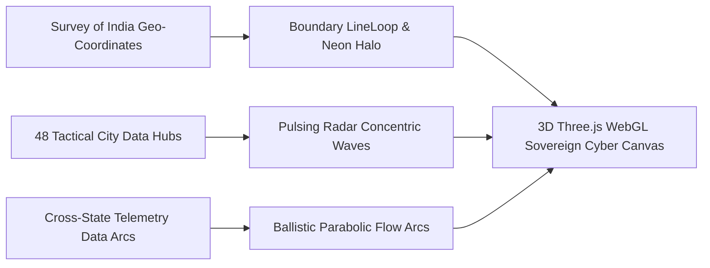
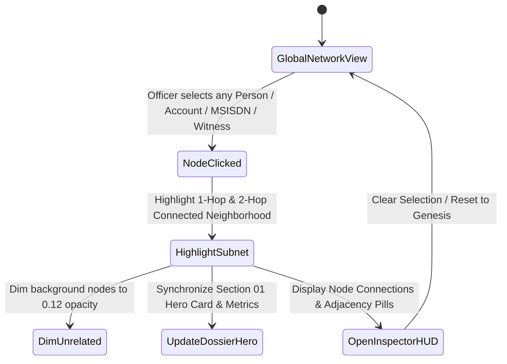
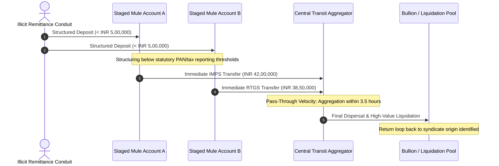
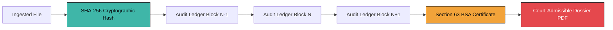

# CaseConnect AI — Criminal Network Analysis & Sovereign Forensic Intelligence Platform

[-00E5FF?style=for-the-badge&logo=nodedotjs&logoColor=white)](https://nodejs.org/)
[](https://www.python.org/)
[](https://fastapi.tiangolo.com/)
[](https://threejs.org/)
[](https://js.cytoscape.org/)
[](https://www.sqlite.org/)
[](https://indiankanoon.org/)
[](LICENSE)

> **Enterprise Forensic Intelligence & Statutory Evidence Correlation Platform**  
> *Engineered for State Police Cyber Cells, Organised Crime Wings, Special Investigation Units, and Central Law Enforcement Agencies.*  
> *Strictly compliant with Section 63 of Bharatiya Sakshya Adhiniyam, 2023 (BSA 2023) and the Digital Personal Data Protection Act, 2023 (DPDP 2023).*  
> *Problem Statement: Criminal Network Analysis System | Team UNITx.*

---

## 🏛️ Executive Intelligence Overview

**CaseConnect AI** is an enterprise-grade forensic investigation platform engineered to resolve evidence fragmentation in high-stakes cyber fraud, hawala routing, and multi-jurisdiction syndicate operations. Indian law enforcement officers routinely ingest disparate, high-volume evidentiary feeds across:
* **Banking Ledgers & Statement Dumps** (IMPS, RTGS, NEFT, UPI transactional logs)
* **Telecommunication Call Detail Records (CDRs) & Subscriber Records (SDRs)**
* **First Information Reports (FIRs) & Seizure Memos**
* **IP Access Logs, SIM-Box Telemetry, and Cyber Checkpoint Data**

CaseConnect AI unifies these heterogeneous streams into an interactive, multi-dimensional **Investigation Graph**, automatically uncovers layered pass-through money loops, isolates off-hour burner telecom spikes, scores attributed leads with explainable mathematical weights, and outputs court-admissible dossiers with cryptographic SHA-256 genesis hashes certified under **Section 63 BSA 2023**.

---

## 🛰️ Dual-Engine System Architecture

CaseConnect AI utilizes a decoupled **Dual-Engine Architecture** combining high-throughput web request routing with heavy asynchronous forensic computing microservices:

```mermaid
graph TB
    subgraph Client Tier ["1. TACTICAL CLIENT TIERS (Port 5173)"]
        direction TB
        C1[Single-Scroll Editorial Dossier UI]
        C2[3D Sovereign India Cyber Map Canvas Three.js]
        C3[Hardware-Accelerated Cytoscape Topological Graph]
        C4[Dynamic Intake Dropzone & File Mapping]
        C5[Floating AI Forensic Copilot Drawer]
    end

    subgraph Gateway Tier ["2. NODE.JS EXPRESS GATEWAY (Port 5000)"]
        direction TB
        G1[Security Headers & Rate-Limiting Policy]
        G2[Bearer Token Auth & Session Management]
        G3[Dynamic Microservice Reverse Proxy]
        G4[Ingress Magic-Byte Sniffer Middleware]
    end

    subgraph Forensic Core ["3. PYTHON COMPUTE ENGINE (Port 8000)"]
        direction TB
        P1[spaCy Legal Named Entity Recognition NER]
        P2[NetworkX Centrality & Louvain Graph Partitioning]
        P3[BFS Multi-Hop Money Layering Loop Tracer]
        P4[Median Absolute Deviation MAD Telecom Anomaly Detector]
        P5[ReportLab Cryptographic Court PDF Generator]
    end

    subgraph Storage Layer ["4. TAMPER-PROOF DATA STORE"]
        direction TB
        S1[(SQLite Transactional DB - Authoritative Source of Truth)]
        S2[(Neo4j Rebuildable Topological Index)]
        S3[Cryptographic SHA-256 Merkle Chain of Custody]
        S4[Secure Local Evidence Repository]
    end

    Client Tier -->|REST / WebSocket| Gateway Tier
    Gateway Tier -->|Forward Forensic Workload| Forensic Core
    Forensic Core -->|State & Audit Writes| Storage Layer
    Storage Layer -.->|Sync Graph Projection| S2
    Storage Layer -.->|Section 63 Verification| P5
```

---

## ⚡ Core Forensic & Intelligence Pillars

### 1. 3D Sovereign Cyber India Map Background
* **Accurate Survey of India Sovereign Boundary**: Explicit high-resolution vector tracing encompassing Jammu & Kashmir, Siachen, Kutch, Kanyakumari, and the Northeast corridor.
* **Internal State Boundary Mesh**: Precise state-wise borders rendered in luminous mint-cyan vector lines.
* **48 Tactical Hub Beacons**: High-intensity glowing yellow/lime nodes (`#FFEA00`) with dynamic concentric radar halos across major cyber hubs (Delhi, Mumbai, Bengaluru, Hyderabad, Surat, Kolkata, Jaipur, Lucknow, Ahmedabad, Guwahati, etc.).
* **Cyber Wireframe HUD**: Horizontal and vertical laser crosshair scanning lines, intersection ticks (`+`), and telemetry coordinate readouts that dynamically tilt and orbit with cursor motion and page scrolling.



---

### 2. Topological Network Graph with Dynamic Click-to-Refocus
* **Wide Spatial Repulsion**: Cytoscape.js configured with expansive node repulsion (`650,000`), long ideal edges (`240px`), and minimal gravity (`0.08`) so large networks remain readable and uncluttered.
* **Dynamic Spread Controls**: One-click `[Spread Graph +]` and `[Tighten -]` multiplier tools to adjust layout density on the fly.
* **Interactive Focal Switching**: Clicking **any** witness, phone number, bank account, or person instantly:
  - Highlights the clicked entity with a glowing amber aura.
  - Highlights its 1st-degree and 2nd-degree connected network while gracefully dimming unrelated nodes (`0.12` opacity).
  - Smoothly pans and centers the camera on the target entity.
  - **Synchronizes the entire investigation dossier**: The Primary Threat Attribution Hero card, telemetry counts, and factor breakdowns immediately re-calculate based on that clicked node.
  - Opens the floating **Active Focal Node Inspector HUD** to explore adjacent degrees and jump between connected entities.



---

### 3. Financial Layering & Rapid Pass-Through Engine
* **Integer Paise Arithmetic**: All financial values are strictly processed as integer paise (`amount_paise`) to prevent floating-point calculation errors in judicial evidence.
* **Layering & Structuring Detection**: Identifies structured fan-in deposits (multiple remittances under statutory reporting thresholds) followed by immediate fan-out dispersal.
* **Pass-Through Loops**: Flags rapid transit movements through mule accounts within configurable time windows (e.g., `< 4 hours`).



---

### 4. Section 63 BSA 2023 Statutory Admissibility & Tamper Demo
* **Electronic Record Compliance**: Electronic evidence complies with Section 63 of Bharatiya Sakshya Adhiniyam, 2023.
* **Genesis-Anchored Cryptographic Audit Log**: Every ingested file, column mapping, entity link, and officer decision is recorded in an immutable SHA-256 chained audit ledger.
* **Interactive Tamper Simulation Demo**:
  - `[⚡ Simulate Tamper Demo]` button in the Evidence Ledger simulates a single-byte bit-flip in stored evidence.
  - Instantly detects cryptographic seal breach, highlights hash mismatch side-by-side, and raises a red chain integrity alert.
  - `[↺ Restore Genesis Hash]` restores verified ledger integrity.
* **Court-Admissible PDF Generation**: Direct generation of Section 63 BSA certified dossiers containing officer attestations, SHA-256 evidence tables, and chronological anomaly findings via ReportLab.



---

### 5. Zero-Hardcoding Dynamic Ingestion Pipeline
* **No Pre-baked Data**: The system operates with zero hardcoded mocks.
* **Dynamic Circle & Bank Detection**: Ingestion algorithms automatically parse and propose alignments for diverse formats:
  - CDR records (Airtel, Jio, Vi, BSNL)
  - Bank exports (SBI, Axis, HDFC, ICICI, PNB)
  - FIR text documents & SDR subscriber sheets
* **Signature-Based Auto-Mapping**: Caches verified column alignments by cryptographic `header_signature` for zero-configuration repeat ingestion.

---

## 📊 Comprehensive Technology Matrix

| Subsystem | Technology | Architectural Role | Key Standard / Benchmark |
| :--- | :--- | :--- | :--- |
| **API Gateway** | [Node.js 20+](https://nodejs.org/) & [Express.js](https://expressjs.com/) | Reverse proxy, security middleware, and session gate | Port 5000 / Sub-millisecond latency |
| **Forensic Microservice**| [FastAPI](https://fastapi.tiangolo.com/) & [Python 3.11+](https://www.python.org/) | Deep forensic compute, graph mathematics, and PDF compilation | Port 8000 / Asynchronous non-blocking |
| **Transactional DB** | [SQLite](https://www.sqlite.org/) & [SQLAlchemy 2.0](https://www.sqlalchemy.org/) | Authoritative, tamper-evident primary store | ACID Compliant / Zero configuration |
| **Graph Infrastructure**| [NetworkX](https://networkx.org/) & [Neo4j](https://neo4j.com/) | Louvain clustering, degree centrality, BFS pathfinding | Dynamic In-Memory + Cypher Querying |
| **Judicial PDF Engine** | [ReportLab](https://www.reportlab.com/) | Pixel-perfect Section 63 BSA court dossier generation | Two-Pass Cryptographic SHA-256 |
| **Frontend Framework** | [React 18](https://react.dev/) & [Vite](https://vitejs.dev/) | High-performance single-scroll editorial workspace | Port 5173 / Sub-second HMR |
| **3D Sovereign Canvas** | [Three.js](https://threejs.org/) | 3D Sovereign India cyber map and particle simulation | 60 FPS WebGL / Hardware Accelerated |
| **Interactive Graph** | [Cytoscape.js 3.28](https://js.cytoscape.org/) | Topological graph canvas with physics repulsion | COSE / Concentric / Circle Layouts |
| **Analytical Visuals** | [Recharts](https://recharts.org/) | Call spike timelines, layering histograms, curfew heatmaps | Responsive SVG Forensics |
| **Legal NLP** | [spaCy](https://spacy.io/) (`en_core_web_sm`) | Named entity extraction from Indian legal and FIR texts | Contextual Rule + ML NER |

---

## 🔒 Security & Statutory Admissibility Standards

CaseConnect AI is governed by strict law-enforcement security protocols:
* **Section 63 BSA 2023 Compliance**: Cryptographic chain of custody guarantees that all analyzed records retain mathematical proof of origin and un-tampered state.
* **Zero Prejudicial Terminology**: UI copy and analytical reports avoid inflammatory labels; findings are presented using neutral, objective terminology (*Primary Lead*, *Attributed Entity*, *Potential Anomaly*).
* **Role-Based Access Control (RBAC)**: Enforces role isolation (`Admin`, `Investigator`, `Viewer`) with Bcrypt password hashing (12 salt rounds) and stateless JWT verification.
* **BOLA / IDOR Defense**: Every case-scoped endpoint strictly verifies officer assignment before returning evidentiary records.

---

## 👨‍💻 Team & Institutional Attribution

* **Platform Name**: CaseConnect AI — Criminal Network Analysis System
* **Development Team**: Team UNITx
* **Institutional Standard**: Designed in alignment with Indian Law Enforcement specifications under Bharatiya Sakshya Adhiniyam, 2023.

---
*CaseConnect AI is an advanced investigative support system. All analytical leads require explicit officer confirmation under standard statutory procedures.*
