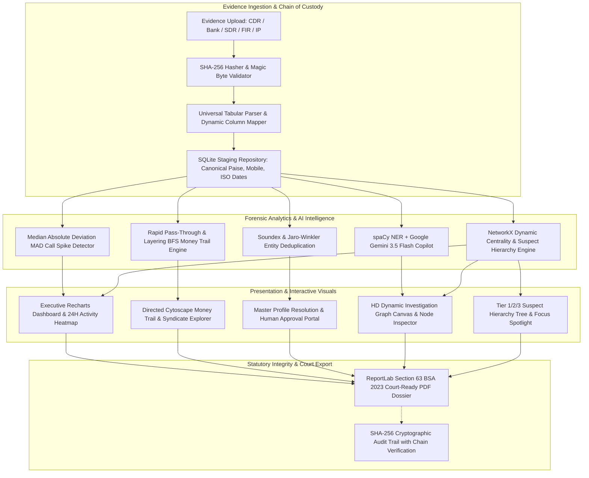

# Case Connect AI — Criminal Network Analysis System

[](https://www.python.org/)
[](https://fastapi.tiangolo.com/)
[](https://react.dev/)
[](https://js.cytoscape.org/)
[](https://www.docker.com/)
[](https://indiankanoon.org/)

> **Statutory Evidence Aggregator & Explainable Investigation Engine**  
> *Compliant with Section 63 of Bharatiya Sakshya Adhiniyam, 2023 (BSA 2023) & DPDP Act 2023*  
> *Engineered from first principles for Smart India Hackathon (Problem Statement: SIH26189 | Team UNITx)*

---

Case Connect AI is an enterprise-grade forensic investigation platform engineered for Indian Law Enforcement Agencies (State Police Cyber Cells, Crime Branches, and Central Special Cells). It unifies fragmented evidence streams—Call Detail Records (CDRs), multi-bank statement exports, mobile Subscriber Detail Records (SDR), IP event logs, and police First Information Reports (FIRs)—into a single high-integrity investigation graph with explainable lead recommendations and tamper-evident audit trails.

---

## 1. Quickstart — Run the Platform

### Option A: One-Command Docker Run (Zero Setup Required)
Run the entire platform (Frontend, Backend, and Neo4j) with **zero local dependencies** (no Python, Node.js, or local database required):

```bash
# 1. Clone repository
git clone https://github.com/yatharth202-jpg/Case-Connect.git
cd Case-Connect

# 2. Launch complete system
docker compose up --build
```
Open **`http://localhost:5173`** in your browser.

---

### Option B: Local Developer Run (In 6 Commands)

#### Prerequisites
- Python 3.11+
- Node.js 20+
- Docker Desktop (or Neo4j Community Server 5.x)
- Git

```bash
# 1. Clone repository
git clone https://github.com/yatharth202-jpg/Case-Connect.git
cd Case-Connect

# 2. Run system preflight validator
python scripts/preflight.py

# 3. Setup backend environment and install dependencies
python -m venv .venv
.venv\Scripts\activate  # Linux/macOS: source .venv/bin/activate
pip install -r backend/requirements.txt
python -m spacy download en_core_web_sm

# 4. Setup frontend dependencies
cd frontend && npm install && cd ..

# 5. Initialize database, seed schema & test accounts
python scripts/reset_db.py --force
python scripts/seed_users.py --defaults

# 6. Launch platform servers (FastAPI backend + Vite frontend)
python scripts/start.py
```

Open browser to **`http://localhost:5173`**  

### 🔑 Default Officer Access Credentials

| Role | Username | Password | Permissions |
| :--- | :--- | :--- | :--- |
| **Supervisory Admin** | `admin` | `AdminPass1234!` | Full case control, user provisioning, immutable audit log verification |
| **Lead Investigator** | `investigator1` | `OfficerPass1234!` | Evidence ingestion, graph review, entity linking, dossier export |
| **Intelligence Analyst** | `viewer1` | `ViewerPass1234!` | Read-only access to network visualizations and analytics charts |

---

### Option C: Cloud Deployment on Render.com (LinkedIn Live URL)
Deploy a live, persistent cloud instance in 5 minutes without needing a credit card:

1. Sign up on [Render.com](https://render.com) using your GitHub account.
2. Click **New +** → **Web Service** and connect repository `yatharth202-jpg/Case-Connect`.
3. Configure settings:
   - **Environment:** `Python 3`
   - **Build Command:**  
     ```bash
     pip install -r backend/requirements.txt && cd frontend && npm install && npm run build && cd ..
     ```
   - **Start Command:**  
     ```bash
     python -m uvicorn backend.app.main:app --host 0.0.0.0 --port $PORT
     ```
   - **Instance Type:** `Free`
4. Add Environment Variable:
   - `GEMINI_API_KEY`: *(Your Google AI Gemini API Key)*
5. Click **Deploy Web Service** to receive your permanent live URL (e.g. `https://case-connect-ai.onrender.com`).

---

## 2. System Architecture



---

## 3. How to Bring Your Own Data

Case Connect AI has **zero hardcoded schemas** and adapts dynamically to unseen formats from telecom operators, commercial banks, and regional police stations.

### Supported File Formats
1. **Call Detail Records (CDR)**: `.csv`, `.xlsx`, `.json`, `.jsonl` (A-Party, B-Party, Date, Time, Duration, Call Type, IMEI, Cell ID).
2. **Bank Transaction Statements**: `.csv`, `.xlsx`, `.json` (Remitter Account, Beneficiary Account, Amount, Date, Reference/Narration). Both multi-column exports and single-account debit/credit ledger sheets are parsed automatically.
3. **Identity Master / SDR / KYC**: `.csv`, `.xlsx` (Name, Phone, Account, Address, Vehicle Registration).
4. **Unstructured Police Documents**: `.txt`, `.pdf`, `.docx` (FIRs, Complaint Letters, Seizure Memos). Processed via deterministic regex and contextual NER.

### Dynamic Column Mapping Flow
1. Upload any file on the **Evidence Repository** tab.
2. System computes the cryptographic SHA-256 fingerprint, inspects headers, strips banner preambles, and computes a unique `header_signature`.
3. An interactive modal displays proposed canonical column alignments (`suggested_mapping`).
4. Officer confirms or modifies alignments.
5. Mapping templates are cached by `header_signature`; future uploads from the same bank branch or telecom circle are mapped automatically with 100% confidence.

### Incremental Multi-Evidence Case Building
- Cases evolve over time as new leads appear. Ingest **Evidence A** (initial narrative or CDR) to generate an initial baseline suspect network.
- Add **Evidence B** (supplementary bank ledger or ANPR camera feed) into the same case docket days later.
- Case Connect AI seamlessly appends records, reconstructs graph topology, and dynamically shifts the suspect ranking in real-time if a higher-degree coordinator is exposed.

### Known Ingestion Boundaries
- **Text PDFs Only**: Scanned image-only PDFs without OCR text streams are not automatically transcribed (OCR engine optional).
- **English & Transliterated Text**: Primary regex heuristics target English and Romanized Indian names.
- **Narrations**: Bank statement parsing currently targets NEFT, RTGS, IMPS, and UPI format strings.

---

## 4. Key Architectural Standards & Non-Negotiables

| Principle | Technical Implementation |
| :--- | :--- |
| **No Hardcoding** | Zero synthetic names, phone numbers, account constants, or dates exist in `backend/app/` or `frontend/src/`. Verified by `audit_hardcode.py`. |
| **No Mock Data** | Production API paths return clean empty arrays when no case evidence is staged; UI displays actionable empty states. |
| **Source of Truth** | SQLite is the authoritative transaction store; Neo4j is a rebuildable, disposable index (`rebuild_graph(case_id)`). |
| **AI Suggests, Officer Decides** | Entity merges and lead priorities are decision recommendations. Merges require explicit human signoff and support instant rollbacks (`Undo Merge`). |
| **Zero Prejudicial Terms** | Strictly bans words like `criminal`, `suspect`, `guilty`, or `mastermind` in formal records. Replaced with `lead for review`, `high-priority entity`, or `potential anomaly`. |
| **Section 63 BSA 2023** | Evidentiary hashes, machine fingerprints, extraction timestamps, and cryptographic audit chains ensure strict court admissibility. |

---

## 5. What We Did NOT Build (Explicit Non-Goals)

To preserve ethical rigor, investigative explainability, and legal admissibility:
1. **No Autonomous Black-Box Merging**: We do NOT silently fuse records with identical surnames or loose similarity without an investigator's recorded decision.
2. **No Facial Recognition / Biometric Scoring**: The platform does not perform probabilistic facial matches or demographic surveillance.
3. **No Automated Prosecution Deciders**: The platform produces analytical leads and anomaly indicators for review—not judicial determinations of guilt.
4. **No Cloud LLM Data Exfiltration**: Sensitive evidence is processed strictly within local air-gapped on-premise infrastructure; no confidential police records are dispatched to third-party public models.

---

## 6. Project Verification & Test Suite

Run the full validation suite locally:

```bash
# 1. Run all 85+ backend integration and unit tests
pytest backend/tests

# 2. Run multi-dataset invariance proof matrix (27 permutations across 3 seeds)
pytest backend/tests/test_multi_dataset.py -s

# 3. Run strict security, offline, and anti-hardcoding auditor
python scripts/audit_hardcode.py

# 4. Run system scale & latency benchmarks
python scripts/perf_benchmark.py

# 5. Verify frontend production bundle
cd frontend && npm run build
```

---

## ⚖️ Statutory Standards & Legal Admissibility

- **Bharatiya Sakshya Adhiniyam, 2023 (BSA 2023) — Section 63**: All electronic records processed by Case Connect AI are paired with SHA-256 integrity proofs, system state attestations, and immutable Genesis-anchored audit logs admissible in judicial court proceedings.
- **Digital Personal Data Protection Act, 2023 (DPDP 2023)**: Processing of personal identifiers is conducted strictly under lawful law enforcement exemptions for crime prevention and detection.

---

## 📜 License & Provenance

Engineered with precision for **Smart India Hackathon (SIH26189)** by **Team UNITx**.  
Licensed under the [MIT License](LICENSE).
