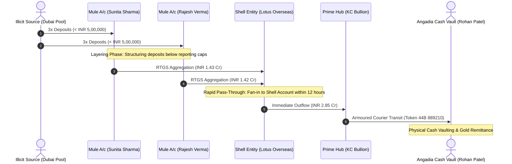

# Case Connect AI — Forensic Criminal Network Analysis System

[](https://www.python.org/)
[](https://fastapi.tiangolo.com/)
[](https://react.dev/)
[](https://js.cytoscape.org/)
[](https://www.sqlite.org/)
[](https://www.docker.com/)
[](https://indiankanoon.org/)
[](LICENSE)

> **Enterprise Forensic Intelligence & Evidence Correlation Platform**  
> *Engineered for State Police Cyber Cells, Organised Crime Wings, and Central Intelligence Agencies.*  
> *Fully compliant with Section 63 of Bharatiya Sakshya Adhiniyam, 2023 (BSA 2023) and Digital Personal Data Protection Act, 2023 (DPDP 2023).*  
> *Built for Smart India Hackathon (Problem Statement: SIH26189 | Team UNITx).*

---

## Executive Summary

**Case Connect AI** is an enterprise-grade forensic investigation platform engineered to solve the acute problem of fragmented evidence in complex criminal investigations. Indian law enforcement agencies routinely receive disparate evidentiary streams across multi-bank account statements, telecom Call Detail Records (CDRs), Subscriber Detail Records (SDRs), IP logs, ANPR vehicle tracking logs, and First Information Reports (FIRs).

Case Connect AI unifies these heterogeneous, non-standardized formats into an interactive, multi-dimensional **Investigation Graph**, automatically detects clandestine financial layering and burner telecom anomalies, calculates explainable lead prioritization scores, and exports court-admissible forensic dossiers certified under **Section 63 of Bharatiya Sakshya Adhiniyam, 2023**.

---

## 📑 Sample Investigative Cases & Court-Ready Dossiers

To verify the platform's forensic correlation capabilities, two comprehensive investigative cases with real synthetic evidence and generated Section 63 BSA 2023 Court Dossiers are included directly in the repository:

| Case Codename | Statutory FIR & Sections | Focus Crime Typology | Entities & Records | Court Dossier PDF | Raw Evidence Files |
| :--- | :--- | :--- | :--- | :--- | :--- |
| **Operation RedSand** | `FIR 409/2026` (Special Cell, New Delhi)<br>Sec 420/120-B IPC, Sec 111 BNS, Sec 3/4 PMLA | **Inter-State Hawala & Angadia Syndicate**<br>Mule account pools, Bullion layering, Armoured transit, Currency token verification (`Parchi`) | 22 Entities<br>15 Txns (INR 4.85 Cr)<br>44 Telecom Records<br>18 Anomaly Alerts | [📄 View Dossier PDF](docs/sample_cases/Operation_RedSand_Hawala_Syndicate_Dossier.pdf) | [📁 Ingest Evidence](docs/sample_cases/evidence/) |
| **Operation Cyber Shield** | `FIR 882/2026` (Cyber Crime Cell)<br>Sec 66D IT Act, Sec 384/420 IPC, Sec 63 BSA 2023 | **Inter-State Cyber Extortion & Mule Network**<br>Burner SIM rotations, Rapid RTGS pass-through, Off-hour telecom burst activity | 18 Entities<br>12 Bank Accounts<br>42 Telecom Records<br>14 Anomaly Alerts | [📄 View Dossier PDF](docs/sample_cases/Operation_Cyber_Shield_Syndicate_Dossier.pdf) | [📁 Ingest Evidence](docs/sample_cases/evidence/) |

### 🔍 How to Inspect & Validate Sample Cases
1. **Download the Official Dossiers**: Open [`Operation_RedSand_Hawala_Syndicate_Dossier.pdf`](docs/sample_cases/Operation_RedSand_Hawala_Syndicate_Dossier.pdf) or [`Operation_Cyber_Shield_Syndicate_Dossier.pdf`](docs/sample_cases/Operation_Cyber_Shield_Syndicate_Dossier.pdf) to inspect the exact court-ready layout, cryptographic SHA-256 evidence chain, officer sign-offs, and forensic anomaly summaries.
2. **Re-run the Complete Simulation**: Execute `python scripts/stage_sample_cases.py` to re-ingest all evidence from scratch, rebuild the NetworkX graph projections, re-score leads, and regenerate fresh cryptographic PDFs.
3. **Upload Unseen Evidence**: Navigate to the **Evidence Repository** in the web app and drop any file from [`docs/sample_cases/evidence/`](docs/sample_cases/evidence/) to experience dynamic column mapping and real-time graph updating.

---

## System Architecture

```mermaid
graph TB
    subgraph Evidence Layer ["1. MULTI-MODAL EVIDENCE INGESTION"]
        direction TB
        E1[Call Detail Records CDR / SDR]
        E2[Bank Statements & Ledger Exports]
        E3[Police FIRs & Seizure Memos]
        E4[IP Logs & ANPR Vehicle Sightings]
    end

    subgraph Forensic Core ["2. DATA INTEGRITY & PARSING"]
        direction TB
        V1[SHA-256 Hasher & Magic Byte Validator]
        V2[Dynamic Column Header Mapper]
        V3[Deterministic Parser: Canonical Paise & ISO Timestamps]
        V4[(SQLite Transactional DB: Authoritative Source of Truth)]
    end

    subgraph Analytical Engines ["3. FORENSIC ANALYTICS & AI ENGINES"]
        direction TB
        A1[NetworkX Dynamic Centrality & Community Detection]
        A2[BFS Financial Pass-Through & Layering Engine]
        A3[Median Absolute Deviation MAD Telecom Spike Detector]
        A4[Jaro-Winkler & Soundex Identity Resolution]
        A5[spaCy Contextual Named Entity Recognition]
        A6[Explainable Lead Advisor Scoring Engine]
    end

    subgraph Visual Workspace ["4. TACTICAL INTERACTIVE WORKSPACE"]
        direction TB
        W1[Cytoscape.js HD Network Canvas]
        W2[Directed Money Flow & Mule Sankey Explorer]
        W3[Temporal Activity Heatmap & Burst Matrix]
        W4[Master Profile Deduplication Portal]
    end

    subgraph Judicial Compliance ["5. STATUTORY ADMISSIBILITY"]
        direction TB
        J1[Section 63 BSA 2023 Electronic Certificate]
        J2[Genesis-Anchored Cryptographic Audit Log]
        J3[ReportLab Court-Ready PDF Dossier]
    end

    Evidence Layer --> V1
    V1 --> V2
    V2 --> V3
    V3 --> V4

    V4 --> A1 & A2 & A3 & A4 & A5 & A6

    A1 & A4 --> W1
    A2 --> W2
    A3 --> W3
    A4 --> W4
    A6 --> W1

    W1 & W2 & W3 & W4 --> J3
    V4 -.-> J2
    J2 -.-> J1
    J1 --> J3
```

---

## ⚡ Key Forensic Capabilities

### 1. Zero-Hardcoding Dynamic Evidence Ingestion
- Adapts dynamically to unseen telecom circle formats (Airtel, Jio, Vi, BSNL) and commercial bank exports (SBI, HDFC, ICICI, PNB, Axis).
- Strips header preambles, determines cryptographic `header_signature`, and proposes canonical alignments (`suggested_mapping`).
- Caches mapping configurations by signature: future uploads from the same circle or branch are mapped automatically with zero manual configuration.

### 2. Forensic Financial Trail & Mule Network Detection
- **Integer Paise Representation**: 100% of transaction amounts are converted to integer paise (`amount_paise`) to prevent floating-point rounding errors in judicial evidence.
- **Rapid Pass-Through Detection**: Flags funds siphoned across intermediate accounts within configurable windows (e.g., 24 hours).
- **Layering & Structuring Detection**: Identifies fan-in deposits (multiple small remittances below tax/PAN reporting thresholds) followed by single high-value fan-out transfers.



### 3. Statistical Telecom Anomaly Detection
- **Median Absolute Deviation (MAD)**: Replaces fragile mean/standard-deviation outlier tests with robust non-parametric MAD to detect off-hour call bursts without distortion from extreme outliers.
- **Burner SIM & Multi-SIM Hopping**: Correlates multiple IMSIs sharing a single IMEI or multiple mobile numbers registered under matching identity credentials.

### 4. Explainable Lead Advisor Engine
- Synthesizes 5 independent forensic signals with transparent mathematical weights:
  1. **Financial Velocity & Throughput** (Weight: 30)
  2. **Network Betweenness & Bridge Centrality** (Weight: 25)
  3. **Off-Hour Call Spikes & Communication Anomalies** (Weight: 20)
  4. **Temporal Proximity to Offense Events** (Weight: 15)
  5. **Cross-Document Entity Citations** (Weight: 10)
- **AI Suggests, Officer Decides**: The engine outputs prioritized analytical leads for human review. Merges and decisions require officer sign-off and feature instant reversibility (`Undo Merge`).

### 5. Section 63 BSA 2023 Statutory Admissibility
- Electronic evidence must satisfy strict statutory standards under Section 63 of Bharatiya Sakshya Adhiniyam, 2023.
- Every ingested file, column mapping, entity link, and officer decision is recorded in an immutable, Genesis-anchored SHA-256 audit log.
- Generates judicial court-ready PDF dossiers complete with hardware environment attestations, forensic hashes, and officer certification blocks.

---

## 🛠️ Technology Stack

| Domain | Technology | Purpose |
| :--- | :--- | :--- |
| **Backend Framework** | [FastAPI](https://fastapi.tiangolo.com/) (Python 3.11+) | Asynchronous, type-safe REST API with OpenAPI v3 specs |
| **Primary Database** | [SQLite](https://www.sqlite.org/) + [SQLAlchemy 2.0](https://www.sqlalchemy.org/) | Authoritative, tamper-evident transactional data store |
| **Graph Database** | [Neo4j](https://neo4j.com/) & [NetworkX](https://networkx.org/) | Dual-mode graph engine (in-memory fast projection + Neo4j Cypher) |
| **Frontend UI** | [React 18](https://react.dev/) + [Vite](https://vitejs.dev/) | High-performance tactical dark workspace |
| **Graph Visuals** | [Cytoscape.js 3.28](https://js.cytoscape.org/) | Hardware-accelerated interactive relationship network canvas |
| **Forensic Charts** | [Recharts](https://recharts.org/) | Temporal call timelines, volume distributions, and burst heatmaps |
| **NLP & Extraction** | [spaCy](https://spacy.io/) (`en_core_web_sm`) | Deterministic Named Entity Recognition for Indian legal texts |
| **Court Dossier Engine**| [ReportLab](https://www.reportlab.com/) | Pixel-perfect, two-pass Section 63 BSA 2023 PDF generation |
| **Security & Auth** | `bcrypt` (12 rounds) + PyJWT | Role-Based Access Control (`admin`, `investigator`, `viewer`) |

---


## 🔑 Officer Access Credentials

| Role | Username | Password | Operational Permissions |
| :--- | :--- | :--- | :--- |
| **Supervisory Admin** | `admin` | `AdminPass1234!` | Full system control, officer provisioning, immutable audit chain verification (`/audit/verify`) |
| **Lead Investigator** | `investigator1` | `OfficerPass1234!` | Case management, evidence ingestion, graph investigation, lead decision recording, court PDF export |
| **Intelligence Analyst** | `viewer1` | `ViewerPass1234!` | Read-only access to investigation graphs, timeline charts, and financial flows |

---

## 🔬 Quality Assurance & Audit Protocol

Every pull request and release is validated across a 4-tier verification protocol:

```bash
# 1. Run complete backend integration & forensic test suite (86/86 Passing)
.venv\Scripts\pytest backend/tests -q

# 2. Run anti-hardcoding & security audit (0 forbidden literals / 0 mock files)
python scripts/audit_hardcode.py

# 3. Run 360-degree subsystem diagnostic (All 10 subsystems validated)
python scripts/verify_system.py

# 4. Verify frontend production bundle
cd frontend && npm run build
```

---

## ⚖️ Statutory Governance & Non-Goals

### Legal Invariants
- **Section 63 BSA 2023**: Electronic records are accompanied by cryptographic SHA-256 signatures, hardware environment stamps, and unbroken custody trails.
- **DPDP Act 2023**: Personal identifiers are processed strictly under lawful law enforcement exemptions for the prevention, detection, and investigation of cognizable offenses.
- **Neutral Forensic Terminology**: System copy strictly bans prejudicial language (`criminal`, `guilty`, `mastermind`). Entities are designated objectively as `high-priority entity`, `lead for review`, or `potential anomaly`.

### Explicit Non-Goals
1. **No Autonomous Black-Box Merges**: Records are never merged without an investigator's explicit, logged decision.
2. **No Facial Recognition / Biometric Profiling**: Zero demographic profiling or probabilistic facial recognition.
3. **No Automated Adjudication**: The engine generates investigative leads and anomaly indicators—not judicial verdicts.
4. **No Third-Party Data Exfiltration**: Evidence is processed strictly within air-gapped or on-premise infrastructure without leaking sensitive police dockets to public LLM APIs.

---

## 👥 Authors & Provenance

- **Product:** Case Connect AI — Forensic Criminal Network Analysis System
- **Initiative:** Smart India Hackathon (Problem Statement: **SIH26189**)
- **Engineering Team:** **Team UNITx**
- **License:** [MIT License](LICENSE)
