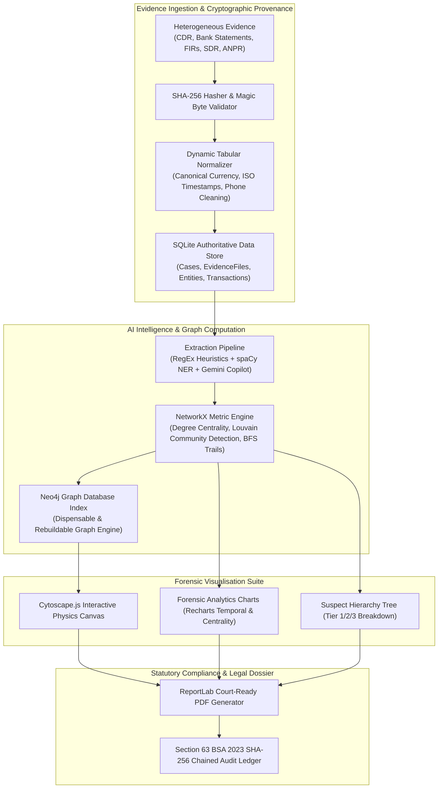

# Case Connect AI — Forensic Criminal Network Analysis & Intelligence Platform

[](https://www.python.org/)
[](https://fastapi.tiangolo.com/)
[](https://react.dev/)
[](https://js.cytoscape.org/)
[](https://www.docker.com/)
[](https://indiankanoon.org/)

> **An enterprise-grade forensic investigation platform engineered from first principles for Indian Law Enforcement Agencies (State Police Cyber Cells, Special Cells, and Crime Investigation Departments).**  
> *Developed for Smart India Hackathon (Problem Statement: SIH26189 | Team UNITx).*

---

## 📌 Executive Summary

Modern criminal investigations are paralyzed by fragmented data silos. Investigators receive heterogeneous evidence streams—telecom Call Detail Records (CDRs), multi-bank statement exports, mobile Subscriber Detail Records (SDR), IP event logs, ANPR vehicle feeds, and First Information Reports (FIRs)—each in incompatible formats, cryptic acronyms, and isolated spreadsheets.

**Case Connect AI** is a full-stack, air-gapped investigative intelligence platform that unifies unstructured and structured evidence into a single high-density knowledge graph. It automates entity extraction, detects communication spikes, reconstructs layered money laundering trails, dynamically calculates suspect hierarchies, and generates court-admissible forensic dossiers with tamper-evident cryptographic provenance.

---

## 🌟 Key Engineering Innovations

### 1. ⚡ 100% Dynamic Runtime Analysis Engine (Zero Hardcoded Mocks)
- **Zero Synthetic Stubs:** The platform contains zero hardcoded suspects or predetermined mock outcomes. Any uploaded police document (`.txt`, `.pdf`, `.csv`, `.xlsx`, `.json`) is parsed, tokenized, and analyzed dynamically in real-time.
- **Multi-Modal Hybrid Extraction:** Fuses regex rule extraction (Indian phone numbers, bank accounts, UPI IDs, PAN, Aadhaar, vehicle registration numbers) with **spaCy Named Entity Recognition (NER)** and **Google Gemini 3.5 Flash Copilot** for narrative understanding and role inference (*kingpin, operator, mule, courier, informant*).

### 2. 🔄 Incremental Multi-Evidence Ingestion & Dynamic Suspect Shifting
- **Iterative Case Building:** Investigations evolve over weeks. Officers can upload **Evidence A** (initial complaint), establishing an initial suspect ranking. Days later, uploading **Evidence B** (supplementary bank ledger or CDR) into the same case docket triggers real-time graph re-computation.
- **Dynamic Suspect Re-ranking:** Automatically recalibrates threat metrics; an initial suspect can be superseded by a previously undetected syndicate boss as new evidentiary connections emerge.

### 3. 🕸️ High-Definition Cytoscape Physics Graph & Interactive Inspector
- **Engineered Physics Layouts:** Powered by Cytoscape.js with force-directed physics (`cose`), concentric centrality hierarchies, circular, and breadth-first layouts with tuned collision repulsion (`nodeRepulsion: 7,500,000`, `idealEdgeLength: 160`) preventing node clutter.
- **HD Node Inspector Drawer:** Clicking any node reveals its cryptographic fingerprint, degree centrality, associated legal sections, and a detailed evidentiary justification checklist explaining *why* the entity is flagged.

### 4. 📊 360° Forensic Analytics Suite
- **24-Hour Temporal Curve:** Spline area charts highlighting peak criminal operational activity hours vs dormant windows.
- **Entity Threat Distribution:** Interactive donut breakdown categorizing persons, accounts, phones, vehicles, and legal FIR tags.
- **Financial Stream Flow:** Tracks high-velocity layered cash movements across banking nodes.
- **Network Centrality Ranking:** Identifies gatekeeper nodes bridging multiple criminal syndicates.

### 5. 🌳 Hierarchical Suspect Threat Tree
- Categorizes suspects into **Tier 1 (Prime Mastermind / Syndicate Head)**, **Tier 2 (Key Operators & Enablers)**, and **Tier 3 (Mules & Peripheral Associates)**.
- Includes a **"Focus in Graph"** trigger that flies the Cytoscape camera directly to the suspect with an animated spotlight.

### 6. ⚖️ Section 63 BSA 2023 Statutory Compliance & Audit Trail
- **Cryptographic Provenance:** Every file ingested is immediately fingerprinted with **SHA-256**.
- **Tamper-Evident Genesis Ledger:** All user actions (logins, evidence uploads, graph merges, report exports) are recorded in an append-only, cryptographic hash-chained audit log compliant with **Section 63 of the Bharatiya Sakshya Adhiniyam, 2023** and the **DPDP Act 2023**.
- **Automated Court Dossiers:** Generates legally verified PDF investigation reports via ReportLab with digital chain of custody stamps.

---

## 🏛️ System Architecture



---

## 🛠️ Technology Stack

| Layer | Technologies | Purpose |
| :--- | :--- | :--- |
| **Frontend** | React 18, Vite, Vanilla CSS, Tailwind CSS | High-performance tactical dark-mode dashboard |
| **Graph Visuals** | Cytoscape.js (v3.28) | Interactive network topology, physics layouts & node inspection |
| **Charts & Metrics** | Recharts (v2.12), Lucide React | 24-Hour temporal curves, threat donuts, financial stream bars |
| **Backend API** | FastAPI, Python 3.11, Uvicorn | Asynchronous, high-throughput REST API server |
| **AI & NLP** | spaCy (`en_core_web_sm`), Google Gemini 3.5 Flash | Named Entity Recognition, legal role inference & modus operandi |
| **Graph Analytics** | NetworkX 3.2, Neo4j 5 Community | Centrality ranking, layering detection, community clustering |
| **Primary Database** | SQLite (Authoritative Transaction Store) | Canonical storage of cases, evidence metadata, and audit ledger |
| **Security & Auth** | PyJWT, Passlib, Bcrypt | Role-Based Access Control (`admin`, `investigator`, `viewer`) |
| **DevOps & Cloud** | Docker, Docker Compose, Nginx, Render | One-click cross-platform deployment and cloud hosting |

---

## 🚀 Deployment & Installation

### Option 1: Docker (Zero-Install Runner — Recommended)
Run the entire platform (Frontend, Backend, and Neo4j) with **zero local dependencies** (no Python, Node, or database installation required on the host system):

```bash
# 1. Clone the repository
git clone https://github.com/yatharth202-jpg/Case-Connect.git
cd Case-Connect

# 2. Launch complete multi-tier system
docker compose up --build
```
Open **`http://localhost:5173`** in your browser.

---

### Option 2: Cloud Deployment on Render.com (Free & LinkedIn Ready)
Deploy a live, public instance in 5 minutes without needing a credit card:

1. Sign up on [Render.com](https://render.com) using your GitHub account.
2. Click **New +** → **Web Service** and connect repository `yatharth202-jpg/Case-Connect`.
3. Configure settings:
   - **Environment:** `Python 3`
   - **Build Command:**  
     ```bash
     pip install -r backend/requirements.txt && cd frontend && npm install && npm run build && cd ..
     ```
   - **Start Command:**  
     ```bash
     python -m uvicorn backend.app.main:app --host 0.0.0.0 --port $PORT
     ```
   - **Instance Type:** `Free`
4. Add Environment Variable:
   - `GEMINI_API_KEY`: *(Your Google AI Gemini API Key)*
5. Click **Deploy Web Service** to receive your permanent live URL (e.g. `https://case-connect-ai.onrender.com`).

---

### Option 3: Local Developer Setup

#### Prerequisites
- Python 3.11+
- Node.js 20+ & npm

```bash
# 1. Setup Backend Virtual Environment
python -m venv .venv
.venv\Scripts\activate   # Linux/macOS: source .venv/bin/activate
pip install -r backend/requirements.txt
python -m spacy download en_core_web_sm

# 2. Setup Frontend
cd frontend
npm install
cd ..

# 3. Configure Environment
cp .env.example .env

# 4. Launch Development Platform
python scripts/start.py
```

---

## 🔑 Default Officer Access Credentials

| Role | Username | Password | Permissions |
| :--- | :--- | :--- | :--- |
| **Supervisory Admin** | `admin` | `AdminPass1234!` | Full case control, user provisioning, immutable audit log verification |
| **Lead Investigator** | `investigator1` | `OfficerPass1234!` | Evidence ingestion, graph review, entity linking, dossier export |
| **Intelligence Analyst** | `viewer1` | `ViewerPass1234!` | Read-only access to network visualizations and analytics charts |

---

## 📂 Repository Structure

```text
Case-Connect/
├── backend/                        # FastAPI Backend Service
│   ├── app/
│   │   ├── audit/                  # Section 63 BSA 2023 Cryptographic Audit Service
│   │   ├── auth/                   # JWT Authentication & RBAC Engine
│   │   ├── cases/                  # Case Management & Settings
│   │   ├── db/                     # SQLite Engine & Neo4j Bolt Driver
│   │   ├── evidence/               # File Ingestion, Magic Byte & SHA-256 Validator
│   │   ├── services/
│   │   │   ├── ai/                 # Gemini 3.5 Flash Copilot & Modus Operandi Generator
│   │   │   ├── analytics/          # Dynamic File Analyzer, Centrality, MAD Spikes
│   │   │   ├── extraction/         # spaCy NER & Regex Extraction Pipeline
│   │   │   ├── graph/              # Cytoscape Graph Topology & Physics Builder
│   │   │   ├── money/              # Hawala Syndicate & Rapid Pass-Through BFS Engine
│   │   │   └── reports/            # Court-Admissible PDF Dossier Generator
│   │   ├── config.py               # Central Settings & Environment Bindings
│   │   └── main.py                 # FastAPI Application Gateway & SPA Static Mount
│   ├── requirements.txt            # Python Dependencies
│   └── Dockerfile                  # Container definition for Backend
├── frontend/                       # React 18 + Vite Intelligence Suite
│   ├── src/
│   │   ├── api/client.js           # Axios Client with Auto-Bearer & Cloud BaseURL
│   │   ├── components/
│   │   │   ├── DynamicInvestigationGraph.jsx # Cytoscape Physics Graph & Node Inspector
│   │   │   ├── ForensicAnalyticsCharts.jsx   # 24H Activity Spline, Donut, Stream Bars
│   │   │   ├── SuspectHierarchyTree.jsx      # Tier 1/2/3 Suspect Hierarchy Tree
│   │   │   ├── DynamicSuspectCard.jsx        # Prime Suspect Real-time Threat Card
│   │   │   └── ...                           # MasterProfiles, Timeline, LeadAdvisor
│   │   ├── pages/
│   │   │   ├── QuickCrimeAnalyser.jsx        # Dynamic Multi-Evidence Upload & Workspace
│   │   │   ├── CaseDetail.jsx                # Deep Investigation Tabs & Money Trails
│   │   │   ├── Cases.jsx                     # Case Management Dashboard
│   │   │   └── AuditLog.jsx                  # Immutable Chain Verification View
│   │   └── App.jsx                 # Client Router & Statutory BSA/DPDP Modals
│   ├── nginx.conf                  # Production Reverse-Proxy Configuration
│   ├── Dockerfile                  # Container definition for Frontend
│   └── vercel.json                 # SPA Rewrites for Cloud Deployments
├── data/synthetic/                 # Sample Demo Datasets (CDRs, Bank CSVs, FIRs)
├── docs/                           # Statutory playbooks, architecture diagrams & specs
├── scripts/                        # Utility & Seeding Scripts (start.py, init_db.py)
├── docker-compose.yml              # 3-Tier Multi-Container Orchestration
└── README.md                       # Comprehensive Technical Documentation
```

---

## 📜 Statutory Standards & Ethical Compliance

1. **Bharatiya Sakshya Adhiniyam, 2023 (BSA 2023) — Section 63**:
   - Electronic evidence admissibility requires uncompromised chain of custody. Every imported piece of evidence is hashed via SHA-256 upon reception and linked to an append-only cryptographic ledger.
2. **Digital Personal Data Protection Act, 2023 (DPDP 2023)**:
   - Processes data strictly under statutory law enforcement exemptions for crime prevention and investigation. Operates air-gapped without telemetry.
3. **Ethical AI Guarantees**:
   - The platform strictly adheres to an **"AI Recommends, Human Decides"** mandate. Algorithms flag patterns and anomalies; official merges and warrant applications require recorded human investigator authorization.

---

## ⚖️ License & Provenance

Engineered with precision for **Smart India Hackathon (SIH26189)** by **Team UNITx**.  
Licensed under the [MIT License](LICENSE).
