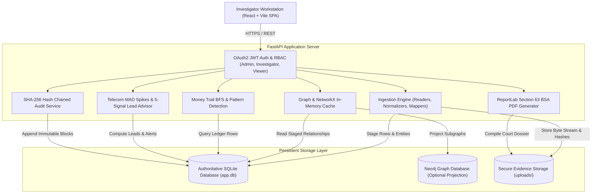
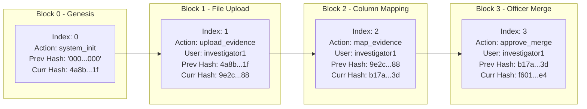

# Case Connect AI — Architectural & Pipeline Diagrams (Mermaid)

> Use these Mermaid diagram sources for documentation, presentations, and technical reports.

---

## 1. System Architecture Diagram



---

## 2. Evidence Ingestion & Normalization Pipeline

```mermaid
flowchart LR
    Upload["Raw File Upload (.csv, .xlsx, .json, .txt, .pdf)"] --> Hash["Compute SHA-256 Fingerprint"]
    Hash --> Validate["Magic Byte & Extension Validation"]
    Validate --> Classify{"File Category?"}

    Classify -->|Tabular: CDR / Bank / SDR| Parse["Universal Tabular Reader (Strip Banners)"]
    Classify -->|Unstructured: FIR / Seizure| DocNLP["Text Extractor & Rule-based NER"]

    Parse --> Map["Dynamic Header Alignment (Jaro-Winkler + Synonyms)"]
    Map --> Template{"Template Cached?"}
    Template -->|Yes| AutoMap["Auto-Apply Confirmed Mapping (1.0 Conf)"]
    Template -->|No| Prompt["Officer Confirmation Modal"]

    AutoMap --> Normalize["Field Normalization (Paise, 10-Digit Mobile, ISO Dates)"]
    Prompt --> Normalize

    Normalize --> Filter{"Row Valid?"}
    Filter -->|Valid| Stage["Stage into SQLite (CallRecord / Transaction)"]
    Filter -->|Malformed| Reject["Log to RejectedRow Table with Line No."]

    Stage --> Audit["Record 'ingest_evidence' in Cryptographic Audit Log"]
    DocNLP --> StagedEntities["Stage Extracted Entities for Officer Review"]
```



---

## 3. Unified Heterogeneous Graph Data Model

```mermaid
graph TD
    Person(("Person Node"))
    Phone(("Phone Node"))
    BankAccount(("BankAccount Node"))
    Vehicle(("Vehicle Node"))
    IPNode(("IP Address Node"))
    FIRNode(("FIR Document Node"))

    Person -->|USES (Conf: 0.95)| Phone
    Person -->|OWNS (Conf: 1.0)| BankAccount
    Person -->|DRIVES (Conf: 0.90)| Vehicle
    Person -->|MENTIONED_IN| FIRNode

    Phone -->|CALLS (Duration, Date, MAD Spike)| Phone
    BankAccount -->|TRANSFERRED_TO (Amount Paise, Ref)| BankAccount
    Phone -->|SEEN_ON_IP| IPNode
    BankAccount -->|LOGGED_FROM| IPNode
```

---

## 4. Cryptographic Section 63 BSA 2023 Audit Hash Chain


